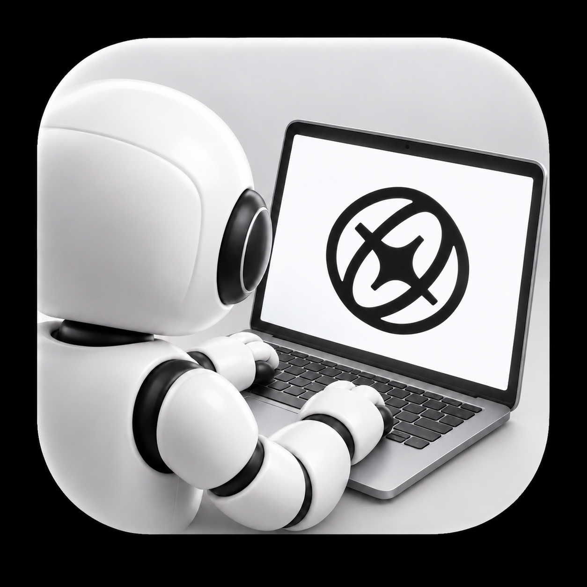

<p align="center">
  
</p>

<h1 align="center">Aside Automation Creator</h1>

<p align="center">
  <strong>반복 업무를, 대화로 만드는 자동화.</strong><br>
  실제 작업을 함께 따라가고, 확인한 절차를 다시 실행하는 Aside 스킬.
</p>

<p align="center">
  <a href="https://github.com/2JIHAN/aside-automation-creator/releases/latest"></a>
</p>

<p align="center">
  <a href="#시작하기">시작하기</a> &nbsp; / &nbsp;
  <a href="#macos와-명령줄-설치">macOS 설치</a> &nbsp; / &nbsp;
  <a href="#실행과-예약">실행과 예약</a>
</p>

<p align="center">
  <a href="https://github.com/2JIHAN/aside-automation-creator/releases/latest"></a>
  <a href="https://github.com/2JIHAN/aside-automation-creator/actions/workflows/windows-release.yml"></a>
</p>

---

## 하던 일을 보여주세요

같은 페이지를 열고, 새 정보를 확인하고, 결과를 정리하는 일이 반복되나요? Aside와 실제 업무를 함께 진행하고, 다음부터 맡길 범위와 예외 대응을 정하세요.

이 스킬은 확인한 절차를 **작업 지침, 실행 흐름, 실행 기록**으로 남깁니다. 처음부터 JSON을 작성할 필요는 없습니다. 에이전트가 파일을 만들고 검증한 뒤, 반복 실행과 예약을 구성합니다.

| 함께 정할 것 | 자동화에 남는 것 |
| --- | --- |
| 어디서 무엇을 할지 | 단계별 작업 지침 |
| 어떤 결과를 정상으로 볼지 | 상태와 다음 단계의 연결 |
| 예외가 나면 멈출지, 복구할지 | 예외 대응과 알림 절차 |
| 언제 다시 실행할지 | 수동 실행 또는 시간 예약 |

자동화 파일은 기본적으로 `~/aside-automations/<slug>/`에 생성합니다. 스킬 설치만으로 업무나 예약 실행이 시작되지는 않습니다.

## 시작하기

### Windows는 클릭해서 설치

**[최신 Windows Setup 다운로드](https://github.com/2JIHAN/aside-automation-creator/releases/latest)**

1. Aside 브라우저를 설치하고 한 번 실행해 프로필을 만드세요.
2. PC에 맞는 Setup.exe를 받으세요. 일반 Intel 또는 AMD PC는 **x64**, Windows ARM PC는 **ARM64**를 선택합니다.
3. 설치 마법사를 마친 뒤 Aside에서 새 채팅을 여세요.

**터미널, Git, Node 사전 설치는 필요 없습니다.** Node는 전용 런타임으로 포함되고, Aside CLI가 없으면 공식 서명과 발행자, 타임스탬프를 검증한 설치기로 준비합니다.

> [!IMPORTANT]
> Setup 자체는 미서명 프로그램이라 Windows SmartScreen 경고가 나타날 수 있습니다. 신뢰하는 릴리즈인지 확인하세요. 브라우저 로그인과 필요한 기기 승인은 직접 진행해야 합니다.

설치기는 현재 Windows 사용자의 기존 프로필에 스킬을 연결합니다. 기존 공통 소스는 전체 백업하고, 계정을 초기화하거나 사용자 암호를 저장하지 않습니다. Node를 전역으로 설치하지 않으며 PowerShell 실행 정책도 설치 프로세스에만 RemoteSigned를 사용합니다. 조직 정책은 우회하지 않습니다. 업데이트할 때는 Setup을 다시 실행하세요.

### 새 채팅에서 업무를 알려주세요

```text
aside-automation-creator로 이 업무를 같이 따라가면서 자동화 만들어줘.
먼저 내가 하는 순서를 보여줄게.
정상으로 볼 기준과 예외가 생겼을 때 멈출 조건도 같이 정하자.
검증이 끝나면 매시간 20분에 실행하고 싶어.
```

같은 채팅에서 실제 작업을 진행하며 대상, 판단 기준, 변경 권한과 알림 대상을 정합니다. 에이전트는 확인한 절차를 파일로 작성하고 검증합니다.

### macOS와 명령줄 설치

<details>
<summary>macOS 설치와 Windows 수동 설치 안내 펼치기</summary>

#### 1. 실행 환경 준비

Aside를 실행하고 사용할 프로필을 만들어 두세요. 아래 설치에는 macOS 또는 Windows와 Git이 필요하며, `npx skills`에는 Node.js 22.20 이상이 필요합니다.

실제 자동화를 실행할 때는 Aside CLI도 설치하고 실행 계정으로 로그인해야 합니다. 스킬 설치만으로 CLI나 로그인 정보가 준비되지는 않습니다.

#### 2. 스킬 설치

터미널에서 실행하고 설치할 AI 도구를 선택하세요.

```sh
npx skills add 2JIHAN/aside-automation-creator
```

이 명령은 `skills`가 지원하는 AI 도구에 설치합니다. Aside는 아직 직접 지원하지 않으므로 다음 단계로 연결하세요. Aside에서만 사용할 경우 이 단계를 생략하고 다음 명령만 실행해도 됩니다.

#### 3. Aside에 스킬 연결

##### macOS

같은 터미널에서 아래 한 줄을 실행하세요.

```sh
curl -fsSL https://raw.githubusercontent.com/2JIHAN/aside-automation-creator/main/install-to-aside.sh | /bin/bash
```

기존의 모든 로컬 프로필에 스킬을 설치하고, 이전 버전이 있으면 백업합니다. 마지막에 설치한 프로필 수 또는 “이미 최신”이라는 메시지가 표시됩니다.

나중에 업데이트하거나 새 프로필을 추가했을 때도 같은 명령을 다시 실행하세요. 로컬 수정이 없으면 공용 저장소를 `git pull --ff-only`로 갱신한 뒤 각 프로필에 반영합니다. 로컬 수정이 있으면 새 소스를 먼저 내려받아 검사하고, 기존 저장소 전체를 `aside-automation-creator.backup-<날짜와 시각>-<PID>`로 보존한 뒤 원래 경로에 새로 설치합니다. 백업은 공용 저장소와 같은 상위 폴더에 남고, 경로는 설치 결과에 표시됩니다. 새 소스 다운로드나 검사가 실패하면 기존 저장소와 프로필을 그대로 유지합니다.

실행 내용을 먼저 확인하려면 [설치 스크립트](install-to-aside.sh)에서 확인 가능합니다.

##### Windows

Aside를 실행하는 **동일한 Windows 사용자**의 일반 PowerShell 창을 사용하세요. 관리자나 SYSTEM 계정으로 설치하거나 예약하지 않습니다. Git과 Node.js를 준비하고 Aside의 Settings > Developers에서 Windows CLI를 설치하세요. 설치 후 새 터미널에서 `Get-Command git, node, aside.exe`로 확인합니다. [공식 CLI 설치 안내](https://docs.aside.com/help/developers)를 참고하세요.

다음 명령은 이 저장소의 설치 파일을 내려받습니다. 파일 내용을 확인한 뒤 해당 파일만 차단 해제하고 실행하세요. 기본 정책이 Restricted인 PC는 클릭 설치를 사용하세요.

```powershell
$installer = Join-Path $env:TEMP 'install-to-aside-automation.ps1'
Invoke-WebRequest -UseBasicParsing -Uri 'https://raw.githubusercontent.com/2JIHAN/aside-automation-creator/main/install-to-aside.ps1' -OutFile $installer
Get-Content -LiteralPath $installer
Unblock-File -LiteralPath $installer
& $installer
```

명령줄 설치는 Git을 사용하며, 프로필은 `$HOME\.aside\u\<번호>`, 공통 소스는 `$HOME\.local\share\aside-automation-creator`를 사용합니다. Setup 패키지로 설치한 소스의 업데이트는 Setup을 다시 실행하세요. 로컬 수정 전체 백업과 이전 스킬 보존은 macOS 설치기와 같은 방식입니다. 조직의 스크립트 실행 정책에 막히면 관리자에게 문의하세요. 시스템 실행 정책을 바꾸거나 인증 정보를 초기화하지 않습니다.

</details>

## 실행과 예약

### Windows

자동화를 만든 폴더에서 실행합니다.

```powershell
.\run.ps1             # 실제 업무 1회 실행
.\install.ps1 -Minute 30  # 매시 30분 예약, 즉시 실행하지 않음
.\uninstall.ps1       # 이 자동화의 예약만 제거
```

예약은 로그인한 사용자의 제한된 권한으로 실행됩니다. Windows에 로그인하고 Aside와 필요한 사이트의 로그인 상태를 유지하세요. 사용자 암호를 저장하거나 SYSTEM 작업으로 등록하지 않습니다. 중복 실행은 건너뜁니다. 예약 분은 PC의 시스템 시간대를 따르며 업무의 TZ 설정과 별개입니다.

기본 Windows CLI는 `$env:LOCALAPPDATA\Aside\CLI\current\aside.exe`입니다. 사용자 지정 설치는 `ASIDE_CLI_PATH`, Node.js는 `ASIDE_NODE_PATH` 또는 공통 소스의 `runtime/node.exe`, 공통 저장소는 `ASIDE_AUTOMATION_CREATOR_REPO`로 지정할 수 있습니다. Windows 실행기는 경로를 확인하고 예약 설치기는 필요한 경로를 실행기에 보존합니다. `ASIDE_CLI_AUTH_PATH`를 사용한다면 인증 파일 경로도 예약 실행에 유지합니다. 인증 파일 내용은 복사하거나 공개하지 않습니다.

Windows PowerShell 5.1에서 한글 경로와 자동화 이름이 깨지지 않게 `.ps1` 파일은 UTF-8 BOM을 유지합니다.

### 확인한 범위

[Windows CI](https://github.com/2JIHAN/aside-automation-creator/actions/runs/41257843880)에서 PowerShell 5.1과 7의 테스트가 각각 22개 통과했습니다. 플랫폼이 다른 실행 파일을 사용하는 테스트 13개는 각각 건너뛰었습니다.

- x64 Setup을 실행해 공식 CLI 최초 설치, 스킬 배포와 내장 Node 실행을 확인했습니다.
- 실제 Windows Task Scheduler에 임시 작업을 등록하고 해제했습니다. 현재 사용자, 제한된 권한, 중복 실행 방지와 파일 보존을 확인했습니다.
- ARM64 Setup은 빌드만 확인했습니다. 실제 ARM PC 설치는 미검증입니다.
- 실제 Aside 로그인, 키 저장소와 브라우저 자동화는 별도 검증이 필요합니다. CI 설치 시험은 임시 프로필을 사용합니다.

<details>
<summary>자동화 파일, 예외 검토와 개발자 안내 펼치기</summary>

## 생성되는 파일

공통 엔진은 `~/.local/share/aside-automation-creator/engine.mjs`에 설치됩니다. 각 자동화의 `run.sh` 또는 `run.ps1`이 실행 계정과 자기 폴더 경로를 전달하며, 엔진은 해당 폴더에서 지침을 읽고 기록을 남깁니다. 자동화 폴더에는 엔진 복사본을 두지 않습니다.

각 자동화 폴더에는 아래 파일들이 만들어집니다.

- `run.sh` 또는 `run.ps1`: 설치된 공통 엔진을 호출합니다.
- `workflow/flow.json`: 상태와 다음 단계의 연결을 정합니다.
- `workflow/context.md`, `workflow/steps/*.md`: 공통 원칙과 각 작업의 지침입니다.
- `workflow/steps/learn.md`, `memory.md`: 조건부 학습 지침과 시나리오별 경험 및 시험 요약입니다.
- `install.sh`, `uninstall.sh` 또는 `install.ps1`, `uninstall.ps1`: 트리거 등록과 해제를 담당합니다.
- `tests/`, `runtime/runs/`: 모의 테스트와 실제 실행 기록 및 증거를 분리합니다.

제공된 시간 트리거는 macOS LaunchAgent 또는 Windows Task Scheduler에서 매시 지정 분에 실행하는 예시입니다. 다른 실행 조건은 작업에 맞게 확인하고 구성합니다. 스킬을 설치하는 것만으로 자동화나 예약 실행이 시작되지는 않습니다.

## 예외 검토와 학습

정상 실행은 업무, 알림과 정리를 마치고 학습 없이 종료합니다. 예외 검토를 거쳤거나 알림 또는 정리가 실패한 실행, 후보를 시험한 실행은 마지막에 learn을 수행합니다. 업무를 복구해 성공한 실행도 포함합니다.

알림은 내용과 날짜 및 시각, 필요한 첨부, 실제 전송과 본문이 보이는 증거까지 확인해야 완료입니다. 실패하면 같은 검토 지침으로 한 번 검토하고, 복구 가능하면 알림 단계에서 재확인합니다. 해결불가이거나 다시 실패하면 정리와 학습으로 넘어갑니다. 이미 보냈거나 전송 여부가 불명확하면 재전송하지 않습니다.

learn은 메모리를 정리하고 필요하면 후보 스텝을 작성합니다. flow의 instructionFile을 후보로 바꿔 다음 실행부터 시험하며, 대상 예외와 정상 동작을 세 차례 정도 검증한 뒤 정식본을 보존하고 채택합니다. 후보가 바뀌면 새로 시험하고, 실패하면 정식 경로로 복귀합니다. 이 판단은 학습 MD를 읽는 에이전트가 수행하며, 엔진이 시험 횟수나 MD 내용의 안전성을 자동 보증하지는 않습니다.

템플릿 업데이트는 기존 시나리오의 지침과 흐름을 자동 교체하지 않습니다. 기존 시나리오는 변경 범위를 확인하고 별도로 적용하세요. 모의 테스트는 흐름과 파일 경로를 검증하며, 실제 사이트에서 학습과 후보 개선이 유효한지는 별도 실행으로 확인해야 합니다.

## 공통 엔진 개발과 검증

저장소에서 다음 명령으로 브라우저 조작 없이 모의 테스트를 실행합니다.

```sh
ASIDE_AUTOMATION_CREATOR_REPO="$PWD" node --test assets/template/tests/scenario.test.mjs tests/install-to-aside.test.mjs
```

공통 저장소를 다른 위치에 설치했다면 실행과 테스트에 `ASIDE_AUTOMATION_CREATOR_REPO`를 같은 경로로 설정하세요. 모든 시나리오가 같은 엔진을 사용하므로 저장소 업데이트는 해당 엔진을 쓰는 자동화 전체에 적용됩니다. 기존 엔진을 보유한 자동화는 자동으로 변경되지 않습니다.

Windows 스크립트 테스트는 PowerShell이 있으면 다음 명령으로 실행합니다. 실행 파일을 찾지 못하면 `POWERSHELL_EXE`에 powershell.exe 또는 pwsh 경로를 지정하세요.

```sh
node --test tests/windows-*.test.mjs
```

</details>
