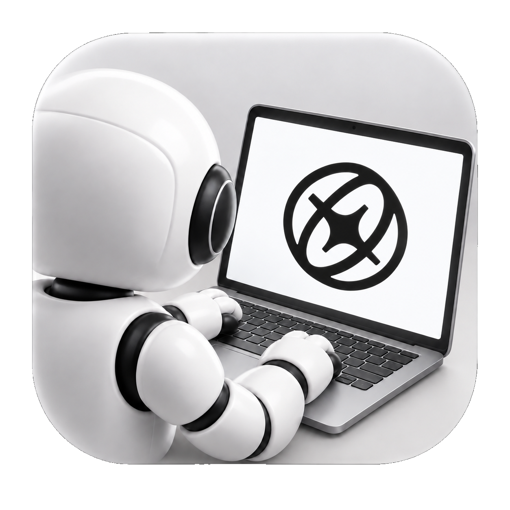

<p align="center">
  
</p>

# Aside Automation Creator

Aside에서 반복할 업무를 가르치고, 같은 순서로 다시 실행하도록 만드는 스킬입니다. 작업을 함께 진행하면서 에이전트가 자동화 할 일을 정합니다.

## 설치하기

먼저 Aside 브라우저를 설치하고 한 번 실행합니다. 이후 아래 다운로드 페이지에서 운영체제에 맞는 설치 파일을 받습니다.

| 운영체제 | 파일 | CPU |
| --- | --- | --- |
| macOS 13.5 이상 | [DMG 다운로드](https://github.com/2JIHAN/aside-automation-creator/releases/latest) | Apple Silicon과 Intel 공용 |
| Windows | [x64 Setup 다운로드](https://github.com/2JIHAN/aside-automation-creator/releases/tag/v0.2.2) | Intel 또는 AMD |
| Windows | [ARM64 Setup 다운로드](https://github.com/2JIHAN/aside-automation-creator/releases/tag/v0.2.2) | Windows ARM |

macOS에서는 DMG 안의 앱을 열고 **앱 설치**를 누릅니다. 앱은 `~/Applications/Aside Automation Creator.app`에 설치되고 메뉴 막대에서 실행됩니다. 로그인 시 실행과 매일 자동 업데이트 확인이 기본으로 켜집니다. 새 버전이 있으면 메뉴에 **업데이트 있음**이 표시되며, 눌러서 변경 내용을 확인하고 설치할 수 있습니다. **자동 다운로드 및 설치**는 메뉴에서 선택할 수 있고 기본값은 꺼짐입니다.

업데이트는 공용 엔진과 모든 로컬 프로필의 제작 스킬을 갱신합니다. 기존 업무 지침과 실행 기록, 예약 설정은 바꾸지 않습니다. 설치가 끝나면 Aside에서 새 채팅을 엽니다.

* Windows에서는 미서명 Setup에 SmartScreen 경고가 표시될 수 있습니다.

## 자동화 만들기

새 채팅에서 다음과 같이  요청합니다.

```text
aside-automation-creator로 ~하는 일을 자동화하려고 해.
먼저 내가 하는 순서대로 같이 진행하자.
```

답변이 오면 자동화하고자 하는 일의 모든 단계를 채팅으로 지시하며 진행합니다.
아래는 예시입니다.

```
예약 관리 페이지에서 새 예약을 확인하고 슬랙으로 알림을 보내주는 일을 하려고 해.

가장 처음으로는 예약 관리 페이지를 열어줘.
```

```
그 다음으로는 새 예약 페이지를 들어가서 새 예약이 있는지 확인해줘.
```

```
만약 새 예약이 있으면 날짜와 고객 이름을 정리해서 내가 지정한 Slack 채널에 보낼 거야.
그 다음으로는 슬랙을 새 탭에 열고 나에게 보내는 메세지를 들어가줘.
```

```
새로 들어온 예약이 있으면 나한테 메세지를 보내줘.
```

```
먼저 실제로 전 과정이 되는 지 확인한 뒤, 매시간 20분에 실행하도록 설정해줘.
```


에이전트가 작업 지침과 실행 파일을 기본적으로 `~/aside-automations/작업명/`에 저장합니다. 예약 시간과 알림 대상, 자동으로 처리해도 되는 범위는 업무에 맞게 정해줍니다.

## 수동 설치

<details>
<summary>펼쳐 보기</summary>

### 설치와 업데이트 시 주의사항

설치기는 기존 로컬 Aside 프로필에 스킬을 연결합니다. 기존 공통 소스를 교체할 때는 전체를 백업하며, 계정을 초기화하거나 사용자 암호를 저장하지 않습니다.

Windows Setup 자체는 미서명 프로그램입니다. Setup이 준비하는 공식 CLI 설치기는 서명과 발행자, 타임스탬프를 검증하지만, 이것이 Setup 자체의 서명을 뜻하지는 않습니다. Node.js는 전용 런타임으로 포함하며 전역으로 설치하지 않습니다. PowerShell 실행 정책은 설치 프로세스에서만 RemoteSigned를 사용하고 조직 정책은 우회하지 않습니다. Setup으로 설치한 소스는 Setup을 다시 실행해 업데이트합니다.

macOS 설치 앱은 Developer ID로 서명하며, 공개 배포 전에 Apple 공증과 Gatekeeper 검사를 확인합니다.

### macOS 수동 설치

Aside를 실행해 프로필을 만든 뒤 Git을 준비합니다. 자동화를 실행할 때는 Node.js와 Aside CLI도 필요합니다. CLI 설치와 로그인은 [공식 안내](https://docs.aside.com/help/developers)에 따라 진행합니다.


같은 터미널에서 아래 명령을 실행합니다.

```sh
curl -fsSL https://raw.githubusercontent.com/2JIHAN/aside-automation-creator/main/install-to-aside.sh | /bin/bash
```

기존의 모든 로컬 프로필에 스킬을 설치하고, 이전 버전이 있으면 백업합니다. 마지막에 설치한 프로필 수 또는 “이미 최신”이라는 메시지가 표시됩니다.

업데이트하거나 새 프로필을 추가했을 때도 같은 명령을 다시 실행합니다. 로컬 수정이 없으면 공용 저장소를 `git pull --ff-only`로 갱신한 뒤 각 프로필에 반영합니다. 로컬 수정이 있으면 새 소스를 먼저 내려받아 검사하고, 기존 저장소 전체를 `aside-automation-creator.backup-<날짜와 시각>-<PID>`로 보존한 뒤 원래 경로에 새로 설치합니다. 백업은 공용 저장소와 같은 상위 폴더에 남고, 경로는 설치 결과에 표시됩니다. 새 소스 다운로드나 검사가 실패하면 기존 저장소와 프로필을 그대로 유지합니다.

실행할 내용은 [설치 스크립트](install-to-aside.sh)에서 미리 확인할 수 있습니다.

### Windows 수동 설치

Aside를 실행하는 **동일한 Windows 사용자**의 일반 PowerShell 창을 사용합니다. 관리자나 SYSTEM 계정으로 설치하거나 예약하지 않습니다. Git과 Node.js를 준비하고 Aside의 Settings > Developers에서 Windows CLI를 설치합니다. 설치 후 새 터미널에서 `Get-Command git, node, aside.exe`로 확인합니다. [공식 CLI 설치 안내](https://docs.aside.com/help/developers)를 참고합니다.

다음 명령은 이 저장소의 설치 파일을 내려받습니다. 파일 내용을 확인한 뒤 해당 파일만 차단 해제하고 실행합니다. 기본 정책이 Restricted인 PC는 위의 Setup으로 설치합니다.

```powershell
$installer = Join-Path $env:TEMP 'install-to-aside-automation.ps1'
Invoke-WebRequest -UseBasicParsing -Uri 'https://raw.githubusercontent.com/2JIHAN/aside-automation-creator/main/install-to-aside.ps1' -OutFile $installer
Get-Content -LiteralPath $installer
Unblock-File -LiteralPath $installer
& $installer
```

명령줄 설치는 Git을 사용하며, 프로필은 `$HOME\.aside\u\<번호>`, 공통 소스는 `$HOME\.local\share\aside-automation-creator`를 사용합니다. Setup 패키지로 설치한 소스는 Setup을 다시 실행해 업데이트합니다. 로컬 수정 전체 백업과 이전 스킬 보존은 macOS 수동 설치와 같은 방식입니다. 조직의 스크립트 실행 정책에 막히면 관리자에게 문의합니다. 시스템 실행 정책을 바꾸거나 인증 정보를 초기화하지 않습니다.

### Windows 실행과 예약

자동화를 만든 폴더에서 실행합니다.

```powershell
.\run.ps1             # 실제 업무 1회 실행
.\install.ps1 -Minute 30  # 매시 30분 예약, 즉시 실행하지 않음
.\uninstall.ps1       # 이 자동화의 예약만 제거
```

예약은 로그인한 사용자의 제한된 권한으로 실행됩니다. Windows에 로그인하고 Aside와 필요한 사이트의 로그인 상태를 유지합니다. 사용자 암호를 저장하거나 SYSTEM 작업으로 등록하지 않습니다. 중복 실행은 건너뜁니다. 예약 분은 PC의 시스템 시간대를 따르며 업무의 TZ 설정과 별개입니다.

기본 Windows CLI는 `$env:LOCALAPPDATA\Aside\CLI\current\aside.exe`입니다. 사용자 지정 설치는 `ASIDE_CLI_PATH`, Node.js는 `ASIDE_NODE_PATH` 또는 공통 소스의 `runtime/node.exe`, 공통 저장소는 `ASIDE_AUTOMATION_CREATOR_REPO`로 지정할 수 있습니다. Windows 실행기는 경로를 확인하고 예약 설치기는 필요한 경로를 실행기에 보존합니다. `ASIDE_CLI_AUTH_PATH`를 사용한다면 인증 파일 경로도 예약 실행에 유지합니다. 인증 파일 내용은 복사하거나 공개하지 않습니다.

Windows PowerShell 5.1에서 한글 경로와 자동화 이름이 깨지지 않게 `.ps1` 파일은 UTF-8 BOM을 유지합니다.

</details>
